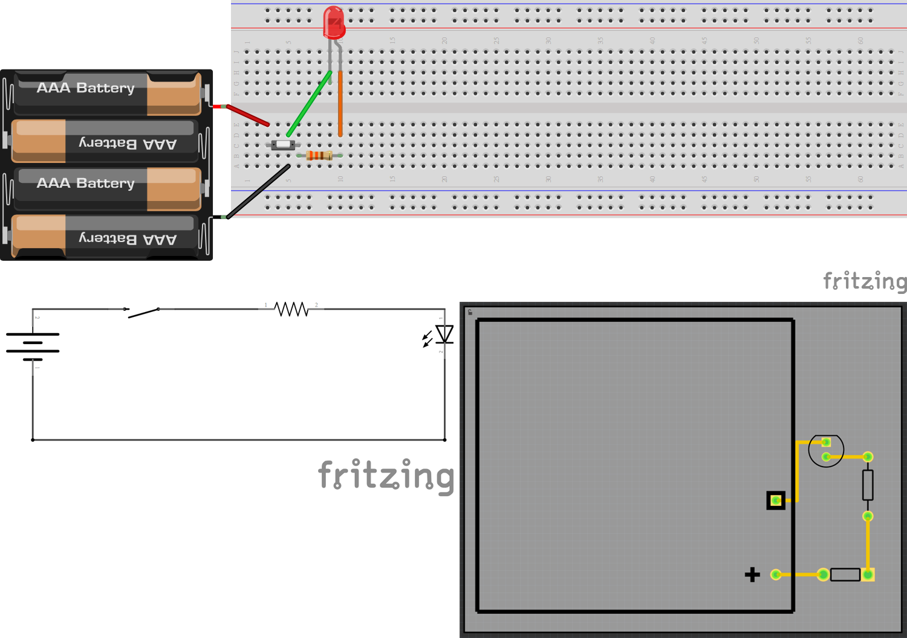

# A Fritzing skill for Claude Code

This repository holds a skill that teaches Claude Code to build Fritzing sketches from code. Fritzing is a free program for drawing electronic circuits. You describe a circuit in plain words, and Claude Code writes one `.fzz` file with three views of it: a breadboard view, a schematic view, and a PCB view. You then open the file in Fritzing and look at it.



The picture shows the example in this repository. The circuit is a 4 x AAA battery holder, a push button, a 330 ohm resistor, and a red LED in a loop. The breadboard view is on top. The schematic view is bottom left and the PCB view is bottom right. The PCB picture is a screenshot of the Fritzing window. It shows the silkscreen outlines of the parts, and the green dots mark connected pins.

## What you need

- Claude Code, installed and signed in. Anthropic explains how in its [quickstart](https://code.claude.com/docs/en/quickstart).
- Fritzing, installed. Download it from [fritzing.org](https://fritzing.org).
- Python 3. The scripts use only the standard library, so you do not install any package.

The author tested all of this on Windows 11 and Ubuntu with Fritzing 1.0.x. It was not tested on macOS. The Windows steps below may need small changes there.

Some words you will meet:

- A skill is a folder of instructions that Claude Code reads when your request matches it.
- A plugin is a folder that Claude Code can install as one unit. It can hold skills.
- A marketplace is a list of plugins that Claude Code can read from a GitHub repository.

## Install

Pick one way. All three use the same files.

### Way 1: install it as a plugin from GitHub

Use this way if you want updates later. Run the commands in a terminal, not inside a Claude Code session. `OWNER` is the GitHub account that holds this repository.

1. Add this repository as a marketplace:

   ```powershell
   claude plugin marketplace add OWNER/medium_claude_fritzing
   ```

2. Install the plugin from it:

   ```powershell
   claude plugin install fritzing@medium-claude-fritzing
   ```

3. Check that it is there:

   ```powershell
   claude plugin list
   ```

   The list shows `fritzing@medium-claude-fritzing` with the status `enabled`.

The author tested steps 1 to 3 with a copy of this folder on the same computer, in a separate Claude Code settings folder. The GitHub address form was not tested, because the repository was not public when this was written.

### Way 2: copy the skill folder

Use this way if you do not want a plugin.

1. Download this repository as a zip file from GitHub, or clone it. Unpack it.
2. Copy the folder `skills\fritzing` into your personal skills folder. In PowerShell, from the top folder of the repository:

   ```powershell
   Copy-Item -Recurse .\skills\fritzing "$env:USERPROFILE\.claude\skills\fritzing"
   ```

3. Start a new Claude Code session. Ask: "Which skills do you have?" The answer lists `fritzing`.

Claude Code reads `.claude\skills` in your user folder at the start of a session. The author tested this way.

### Way 3: load it for one session only

Use this way to try the skill without installing anything. From the top folder of the repository:

```powershell
claude --plugin-dir .
```

The skill is loaded for that session only. The author checked that `claude --plugin-dir . plugin list` shows the plugin as `loaded`.

More detail on each way, and the Anthropic pages behind it, is in [docs/ways_to_share.md](docs/ways_to_share.md).

## Try it

Start Claude Code in an empty folder. Type this:

```text
Use the fritzing skill. Build a Fritzing sketch of a 4 x AAA battery holder, a push button, a 330 ohm resistor, and a red LED in a series loop. Use only parts that ship with Fritzing. Make the breadboard, schematic, and PCB views. Then open the file in Fritzing and tell me what you see.
```

Here is what Claude Code should do:

- It reads the skill and finds your Fritzing install.
- It checks each part with `check_core_part.py`. A part whose image files are missing from your install draws blank, so Claude Code should pick another part.
- It copies `build_fzz_battery_led.py` and changes it for your circuit.
- It runs the script. The script checks its own wiring and the PCB trace spacing before it writes the file.
- It exports the three views as SVG files and looks at them. Then it opens the sketch in Fritzing.

At the end you should have one `.fzz` file. Open it yourself: in Fritzing, choose File, then Open. In each of the three tabs the status bar at the bottom should say "Routing completed". That message means every connection in the file has a wire or a trace. For the PCB, choose Routing, then Design Rules Check (Ctrl+Shift+D). Fritzing should say that your sketch is ready for production.

The ready-made result of this prompt is `skills/fritzing/examples/battery_led.fzz`. Open it first if you want to see what a good result looks like. Claude Code may write a different layout on your computer. The author did not test the exact prompt above on a clean install.

For a circuit of your own, describe the parts and the connections:

```text
Use the fritzing skill. I want a Fritzing sketch of [describe your circuit and each part]. Check every part first. Build all three views from one list of connections. Tell me which checks you ran and which you did not run.
```

Start small. Two to six parts is a good size.

## What the skill can and cannot do

- It can build the three views from one net list, which is a list of which pins connect together. It checks that the three views agree.
- It can write a custom part: one `.fzp` file and four SVG files. `skills/fritzing/scripts/build_fzz_header_led.py` shows how.
- It was proven on two small circuits. Each has a breadboard, a schematic, and a PCB with three to four parts.
- It does not use Fritzing's autorouter. It places each trace itself. The autorouter was not tested.
- It cannot see ratsnest lines (the thin lines that show unrouted connections) in an SVG export. A person, or a screenshot of the Fritzing window, must give the last check.
- Do not send a board to a factory because Claude Code wrote it. Open it in Fritzing and check it first.

## When something goes wrong

- A part draws blank. Some core parts have image files missing from the Fritzing install. Run `python skills\fritzing\scripts\check_core_part.py "C:\Program Files\Fritzing\fritzing-parts" <part name>` and pick a part that says `OK`.
- A wire looks connected but Fritzing shows an unrouted line. The file must list each connection on both items. The generator scripts do this with one `link()` call for each pair.
- A part sits beside its holes. The scale is wrong or a rotated part was placed by its corner. `skills/fritzing/references/fz-file-format.md` has the scales and the rotation formulas.
- Two traces cross. Move one to the other copper layer.
- Fritzing does not start from the script. Open the file by hand with File, then Open.

## What is in this repository

- `skills/fritzing/SKILL.md` has the instructions that Claude Code reads.
- `skills/fritzing/scripts/` has the generators and the checkers.
- `skills/fritzing/references/fz-file-format.md` has the facts about the Fritzing file format.
- `skills/fritzing/examples/` has two sketches and a picture of each view.
- `.claude-plugin/` has the two small files that make this repository a plugin and a marketplace.
- `docs/ways_to_share.md` explains how a skill can be shared and what was tested.

## Licence

This repository uses the MIT licence. See the file `LICENSE`.

Fritzing and its parts library belong to their own authors and are not included here. The scripts read the parts library from your own Fritzing install. 